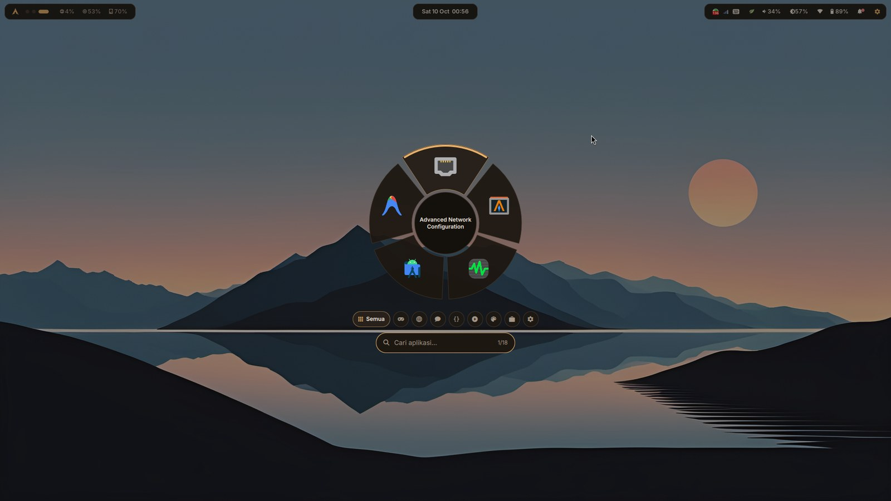
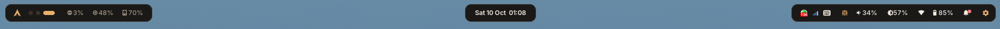
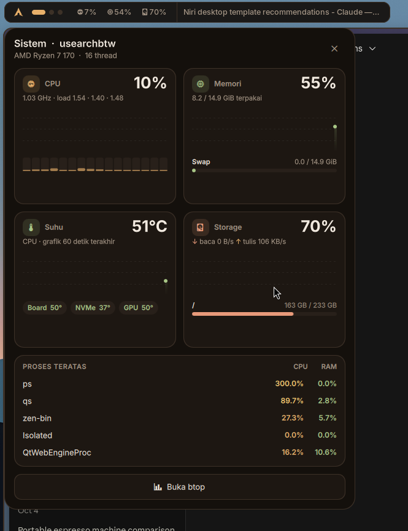
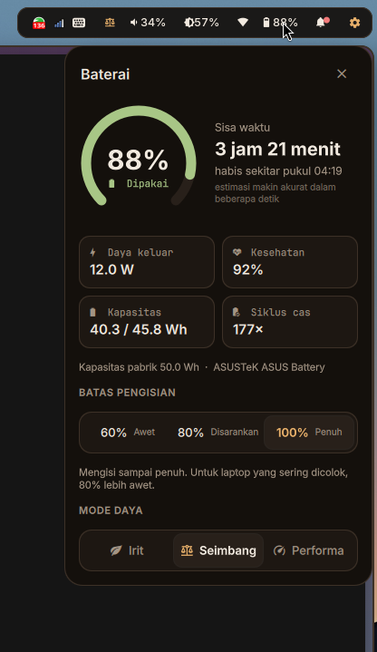
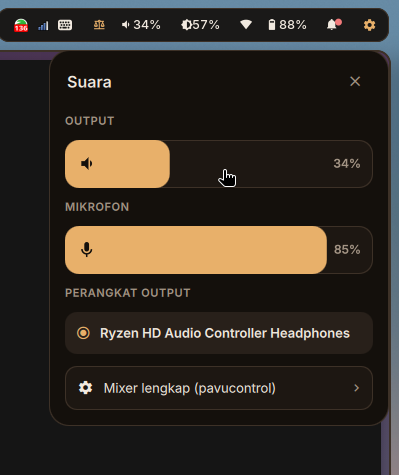
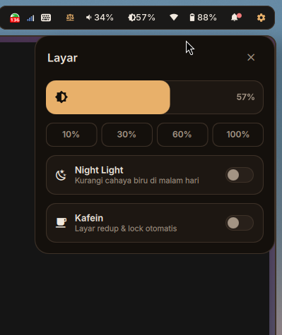
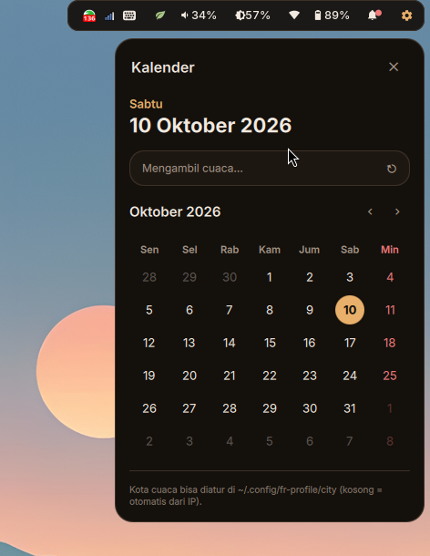
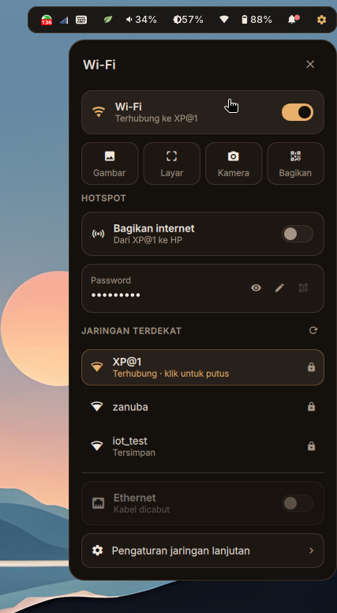
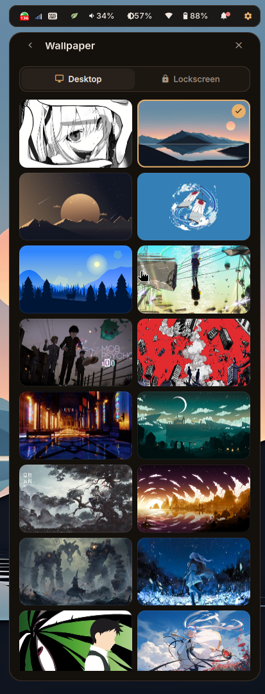
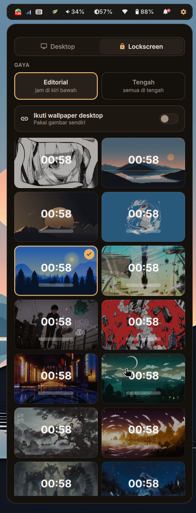

# FR Navy — rice niri yang ringan

Desktop lengkap untuk **Arch Linux + [niri](https://github.com/YaLTeR/niri)**, dibuat sebagai pengganti
Noctalia yang terasa berat. Tampilannya rapi dan konsisten (7 tema warna), fiturnya lengkap
(panel kontrol, launcher, lockscreen, hotspot, Wi-Fi lewat QR), tapi **hampir tidak ada yang jalan
di latar belakang**.



<sub>Semua screenshot memakai tema <b>Kopi</b>.</sub>

---

## Daftar isi

- [Kenapa ringan](#kenapa-ringan)
- [Pasang](#pasang)
- [Fitur](#fitur)
  - [Waybar](#waybar) · [Panel kontrol](#panel-kontrol) · [Launcher](#launcher) · [Monitor sistem](#monitor-sistem)
  - [Baterai](#baterai) · [Suara & layar](#suara--layar) · [Kalender & cuaca](#kalender--cuaca)
  - [Wi-Fi, QR & hotspot](#wi-fi-qr--hotspot) · [Wallpaper & lockscreen](#wallpaper--lockscreen)
  - [Tema](#tema) · [Mode daya](#mode-daya) · [Clipboard & emoji](#clipboard--emoji) · [Alat](#alat)
- [Keybind](#keybind)
- [Perintah](#perintah)
- [Dotfiles pribadi](#dotfiles-pribadi)
- [Masalah umum](#masalah-umum)
- [Struktur repo](#struktur-repo)

---

## Kenapa ringan

| Selalu jalan | Fungsi |
|---|---|
| `waybar` | bar atas |
| `swaync` | notifikasi |
| `hypridle` | redup & kunci layar otomatis |
| `awww-daemon` | wallpaper |
| `wl-paste --watch` | pencatat riwayat clipboard (idle kalau tidak ada salinan baru) |

Selain lima itu, **semua panel hanya hidup saat dibuka**: panel kontrol, popup waybar, launcher,
monitor sistem, dan layar pilih QR adalah aplikasi Quickshell kecil yang dijalankan saat diklik
dan langsung keluar saat ditutup (`Esc` atau klik di luar).

Skrip pendukung (`fr-*`) juga tidak punya proses latar. Mode daya otomatis ikut charger adalah
pengecualian yang bisa dinyalakan/dimatikan sendiri.

---

## Pasang

**Kebutuhan dasar:** Arch Linux, niri, `quickshell`, `waybar`, `swaync`, `fuzzel`, `hyprlock`,
`hypridle`, `awww`, NetworkManager, font **Inter** + **JetBrainsMono Nerd Font**, ikon **Papirus**.
Paket lain (playerctl, grim, slurp, satty, cliphist, hostapd, dnsmasq, qrencode, zxing-cpp, dll.)
ditawarkan otomatis oleh installer. `gpu-screen-recorder` untuk rekam layar ada di AUR.

```bash
git clone https://github.com/takumifahri/Unemployment-SE-Niri-Rice.git ~/Unemployment-SE-Niri-Rice
cd ~/Unemployment-SE-Niri-Rice
./update.sh
```

`update.sh` aman dijalankan berkali-kali, dan dipakai juga untuk memperbarui. Yang dilakukannya:

1. Menawarkan paket yang belum terpasang (`pacman`).
2. Menyalin skrip ke `~/.local/bin` dan config ke `~/.config/…`.
3. Menambahkan `include` ke `~/.config/niri/config.kdl` (config lama dibackup dulu).
4. Memasang helper root kecil untuk hotspot & batas pengisian baterai (minta `sudo` sekali).
5. Memasang ulang tema yang sedang kamu pakai.

Setelah itu pastikan `~/.local/bin` ada di `PATH`, lalu pasang tombol untuk launcher dan panel
kontrol di `~/.config/niri/config.kdl`:

```kdl
binds {
    Mod+D { spawn "sh" "-c" "$HOME/.local/bin/fr-toggle radial-launcher"; }
    Mod+A { spawn "sh" "-c" "$HOME/.local/bin/fr-toggle fr-control"; }
}
```

```bash
echo 'export PATH="$HOME/.local/bin:$PATH"' >> ~/.zshrc
```

---

## Fitur

### Waybar

Bar tiga bagian berbentuk pil:  


- **Kiri** — logo (klik → launcher), workspace berbentuk titik, CPU / RAM / disk (klik → monitor sistem).
- **Tengah** — tanggal & jam (klik → kalender).
- **Kanan** — indikator rekam layar & hotspot (hanya muncul saat aktif), tray, mode daya, volume,
  brightness, Wi-Fi, baterai, notifikasi, dan tombol panel kontrol.

Ikon volume, brightness, Wi-Fi, baterai, dan jam masing-masing membuka **popup kecil** khusus
untuknya, jadi tidak perlu membuka panel kontrol penuh.

### Panel kontrol

Satu panel di kanan atas untuk semua pengaturan cepat: Wi-Fi, Ethernet, Bluetooth,
Jangan Ganggu, Night Light, Kafein, slider volume & brightness, mode daya, now-playing (lagu yang
sedang diputar dari Spotify/YouTube/dll.), profil dengan foto, serta baris alat (screenshot,
rekam, ambil warna, terminal). Dari panel ini juga bisa membuka halaman wallpaper, monitor,
tema, profil, dan baterai.

### Launcher


Launcher berbentuk **pie 5 irisan** di tengah layar.

- Ketik untuk mencari aplikasi; nama aplikasi terpilih tampil di tengah lingkaran.
- `←` `→` (atau `Tab`) memindah pilihan, scroll atau `PgUp` `PgDn` pindah halaman.
- `↑` `↓` pindah **grup**: Semua, Game, Browser, Sosial, Coding, Media, Grafis, Kantor, Sistem
  (dibaca dari kategori `.desktop` tiap aplikasi; grup kosong tidak ditampilkan).
- `Enter` membuka, `Esc` mengosongkan pencarian atau menutup.
- Ukurannya menyesuaikan tinggi layar.

<br clear="right">

### Monitor sistem



Klik CPU/RAM/disk di waybar kiri. Empat kartu dengan grafik 60 detik terakhir:

- **CPU** — persentase total, frekuensi, load average, bar per-thread.
- **Memori** — RAM terpakai dan swap/zram.
- **Suhu** — CPU plus sensor lain (board, NVMe, GPU).
- **Storage** — kecepatan baca/tulis dan isi tiap partisi.

Di bawahnya lima **proses teratas** (CPU & RAM) dan tombol ke `btop`.
Data diambil oleh satu proses sampler yang ikut berhenti saat panel ditutup.

<br clear="right">

### Baterai



Klik ikon baterai di waybar.

- **Sisa waktu / penuh dalam** — dihitung dari rata-rata daya 30 detik terakhir supaya stabil,
  lengkap dengan perkiraan jam habis atau penuh.
- **Daya, kesehatan, kapasitas, siklus cas** — dibaca langsung dari sysfs.
- **Batas pengisian 60 / 80 / 100%** — baterai berhenti mengisi di angka yang dipilih, supaya
  lebih awet untuk laptop yang sering dicolok. Butuh laptop yang mendukung
  `charge_control_end_threshold` (ASUS, ThinkPad, Framework, dll.). Pilihan diingat dan dipasang
  ulang tiap login.
- **Mode daya** — Irit / Seimbang / Performa (lihat [Mode daya](#mode-daya)).

<br clear="right">

### Suara & layar

| Suara | Layar |
|:---:|:---:|
|  |  |

**Suara** — slider output dan mikrofon (klik ikon untuk mute), pilih perangkat output
(speaker, headset Bluetooth, HDMI), dan pintasan ke `pavucontrol`.

**Layar** — slider brightness dengan pilihan cepat 10/30/60/100%, **Night Light** (mengurangi
cahaya biru, `wlsunset`), dan **Kafein** (menahan layar supaya tidak redup/terkunci, berguna saat
presentasi atau nonton).

### Kalender & cuaca



Klik jam di tengah waybar. Kalender bulanan (Minggu ditandai merah, panah untuk pindah bulan)
dan cuaca saat ini dari wttr.in dalam bahasa Indonesia.

Lokasi cuaca otomatis dari IP. Untuk mengatur sendiri:

```bash
echo "Bogor" > ~/.config/fr-profile/city
```

Data cuaca disimpan 30 menit supaya tidak sering mengambil dari internet.

<br clear="right">

### Wi-Fi, QR & hotspot



Klik ikon Wi-Fi di waybar.

**Sambung lewat QR** (seperti di Android):
- **Gambar** — dari clipboard atau file; misalnya QR yang dikirim teman lewat chat.
  Kalau gambar berisi banyak hal, muncul layar untuk **memilih area QR**.
- **Layar** — pilih area di layar yang berisi QR.
- **Kamera** — scan pakai webcam.
- **Bagikan** — tampilkan QR jaringan yang sedang dipakai supaya HP lain bisa langsung scan.

**Hotspot** — bagikan internet laptop ke HP: *Wi-Fi sekitar → laptop → HP*. Laptop tetap
tersambung ke Wi-Fi selama hotspot menyala (kartu Wi-Fi harus mendukung AP + station
bersamaan; cek dengan `fr-hotspot check`). Panel menampilkan password (bisa diubah), QR untuk
di-scan HP, perangkat yang tersambung, dan data terpakai. Berjalan lewat hostapd + dnsmasq, jadi
bisa dengan backend NetworkManager `iwd` maupun `wpa_supplicant`. Saat dimatikan, semua prosesnya
ikut berhenti.

<br clear="right">

### Wallpaper & lockscreen

| Wallpaper desktop | Wallpaper & gaya lockscreen |
|:---:|:---:|
|  |  |

Panel kontrol → **Wallpaper**. Gambar diambil dari `~/Pictures/Wallpaper`, dengan thumbnail yang
di-cache supaya cepat.

- **Desktop** — klik untuk mengganti, dengan transisi halus.
- **Lockscreen** — bisa memakai gambar sendiri atau mengikuti wallpaper desktop. Pratinjau
  menunjukkan jam di atas tiap gambar.
- **Gaya lockscreen**:
  - *Editorial* — jam besar bertumpuk di kiri bawah, media player di kiri atas, foto profil dan
    kolom password di kanan bawah.
  - *Tengah* — semua di tengah dalam satu kartu.

Lockscreen menampilkan foto profil dan nama tampilan (atur di Panel kontrol → Profil), lagu yang
sedang diputar beserta tombol putar/lewati, serta status baterai dan Wi-Fi.

### Tema

Panel kontrol → **Tema**, atau `fr-theme <nama>`. Satu perintah mengganti warna **semua**
komponen sekaligus: waybar, notifikasi, fuzzel, panel, launcher, monitor sistem, lockscreen, focus
ring niri, dan satty.

| Nama | Nuansa |
|---|---|
| `navy` | biru dongker khas FR (bawaan) |
| `ungu` | violet lembut |
| `sakura` | pink hangat |
| `kopi` | cokelat & karamel |
| `hutan` | hijau daun |
| `laut` | biru kehijauan |
| `grafit` | monokrom tenang |

Semua tema lolos kontras teks WCAG ≥ 4.5:1. File yang sudah kamu ubah sendiri tetap aman, karena
yang diganti hanya nilai warnanya.

### Mode daya

Tiga mode (pakai power-profiles-daemon), dari panel atau `fr-power`:

| Mode | Efek |
|---|---|
| **Irit** | CPU hemat, animasi & bayangan niri dimatikan, brightness dibatasi 40% |
| **Seimbang** | normal |
| **Performa** | CPU maksimal |

Opsi **otomatis ikut charger**: Irit saat pakai baterai, kembali ke pilihanmu saat dicolok.
Rice-nya sendiri tidak mengubah apa pun yang bisa mengganggu aplikasi seperti Zoom.

### Clipboard & emoji

- `Mod+Alt+V` — **riwayat clipboard**: pilih teks atau gambar yang pernah disalin untuk disalin
  lagi. `fr-clip delete` menghapus satu entri, `fr-clip wipe` menghapus semua. Isi dari pengelola
  password tidak dicatat.
- `Mod+Alt+E` — **pemilih emoji**: cari pakai bahasa Inggris atau kata Indonesia (*kopi*, *ngakak*,
  *jempol*, *api*). Emoji disalin dan langsung diketik ke jendela aktif (kalau `wtype` terpasang).
  Yang terakhir dipakai muncul paling atas.

### Alat

| Alat | Tombol | Keterangan |
|---|---|---|
| Screenshot area | `Mod+Shift+S` | pilih area, lalu coret/beri panah/blur di satty |
| Screenshot layar | `Mod+Ctrl+S` | seluruh layar ke satty |
| Rekam layar | `Mod+Alt+R` | mulai/berhenti; indikator merah di waybar selama merekam |
| Ambil warna | `Mod+Alt+C` | klik piksel mana saja, kode hex masuk clipboard |
| Terminal scratchpad | `Mod+Grave` | terminal melayang yang muncul/sembunyi |

---

## Keybind

Keybind tambahan ada di `niri/fr-binds.kdl` (di-include otomatis). Semuanya juga tampil di
daftar keybind niri: **`Mod+Shift+/`**.

| Tombol | Aksi |
|---|---|
| `Mod+Shift+S` | screenshot area → satty |
| `Mod+Ctrl+S` | screenshot layar → satty |
| `Mod+Alt+R` | rekam layar mulai/berhenti |
| `Mod+Alt+C` | ambil warna |
| `Mod+Alt+V` | riwayat clipboard |
| `Mod+Alt+E` | pilih emoji |
| `Mod+Grave` | terminal scratchpad |

---

## Perintah

| Perintah | Fungsi |
|---|---|
| `fr-toggle <panel> [halaman]` | buka/tutup panel (`radial-launcher`, `fr-control`, `fr-sysmon`; halaman: `wifi`, `volume`, `brightness`, `battery`, `calendar`) |
| `fr-theme <nama>` / `fr-theme list` | ganti tema / daftar tema |
| `fr-lockstyle editorial\|center` | gaya lockscreen |
| `fr-power power-saver\|balanced\|performance` | mode daya |
| `fr-charge set 80` | batas pengisian baterai (40–100) |
| `fr-hotspot on\|off\|check\|qr` | hotspot |
| `fr-hotspot set ssid NAMA` / `set pass SANDI` | ubah nama / password hotspot |
| `fr-wifiqr image\|screen\|cam\|share` | Wi-Fi lewat QR |
| `fr-clip [delete\|wipe]` | riwayat clipboard |
| `fr-emoji` | pemilih emoji |
| `fr-shot region\|screen`, `fr-rec toggle`, `fr-pick`, `fr-scratch` | alat |

---

## Dotfiles pribadi

Config yang memang milikmu disimpan terpisah di folder `personal/`, supaya bisa ikut Git:
niri `config.kdl`, tema aktif, nama tampilan, kota cuaca, gaya lockscreen, dan batas pengisian.

```bash
./snapshot.sh                 # salin config pribadi dari laptop ke personal/
./snapshot.sh --with-photo    # + foto profil (jangan kalau repo publik)
git add -A && git commit -m "snapshot" && git push
```

Di laptop baru cukup `git clone` lalu `./update.sh`. Isi `personal/` dipulihkan otomatis, tapi hanya
untuk file yang belum ada. Config bawaan yang dibuat niri saat pertama jalan dibackup lalu diganti.

> Password hotspot, password Wi-Fi, dan riwayat clipboard **tidak pernah** ikut tersalin.

---

## Masalah umum

| Gejala | Solusi |
|---|---|
| `command not found: fr-…` | tambahkan `~/.local/bin` ke `PATH` |
| Panel tidak muncul saat diklik | jalankan `qs -p ~/.config/fr-control/shell.qml` di terminal untuk melihat error |
| Hotspot menyala, tapi HP tidak dapat IP | firewall memblokir. UFW diizinkan otomatis; firewalld perlu izin manual untuk antarmuka `frap0` |
| Hotspot gagal memancar di 5 GHz | atur negara Wi-Fi: pasang `wireless-regdb`, isi `WIRELESS_REGDOM="ID"` di `/etc/conf.d/wireless-regdom`, reboot |
| Tidak yakin kartu Wi-Fi bisa hotspot | `fr-hotspot check` |
| Batas pengisian tidak muncul | laptop tidak punya `charge_control_end_threshold` di `/sys/class/power_supply/BAT*/` |
| Menu fuzzel terlalu besar/kecil | ubah `size=` di `~/.config/fuzzel/fuzzel.ini` |
| Lockscreen tidak berubah | `fr-lockstyle editorial` (atau `center`) |
| Cuaca salah kota | isi nama kota di `~/.config/fr-profile/city` |
| Lupa keybind | `Mod+Shift+/` |

---

## Struktur repo

```
bin/              skrip fr-* (dipasang ke ~/.local/bin)
control-center/   panel kontrol + popup waybar (Quickshell)
radial-launcher/  launcher pie
sysmon/           monitor sistem
wifiqr/           layar pilih area QR
waybar/  swaync/  fuzzel/  hypr/  satty/     config tiap komponen
niri/             fr-binds.kdl (di-include otomatis) + rice-snippet.kdl (contoh layout)
theme/            themes.json — palet 7 tema
emoji/            daftar emoji + kata kunci Indonesia
systemd/          service user (mode daya otomatis, batas pengisian)
applications/     entri "Buka dengan Wi-Fi QR" untuk file manager
docs/             screenshot README
personal/         config pribadimu (dibuat ./snapshot.sh)
update.sh         installer & updater
snapshot.sh       simpan config pribadi ke personal/
```

---

<sub>Palet bawaan (Navy): bg <code>#0B0F17</code> · surface <code>#121826</code> · accent <code>#6EA8FE</code> ·
teks <code>#E6EAF2</code>. Font: Inter (teks) dan JetBrainsMono Nerd Font (ikon).</sub>
